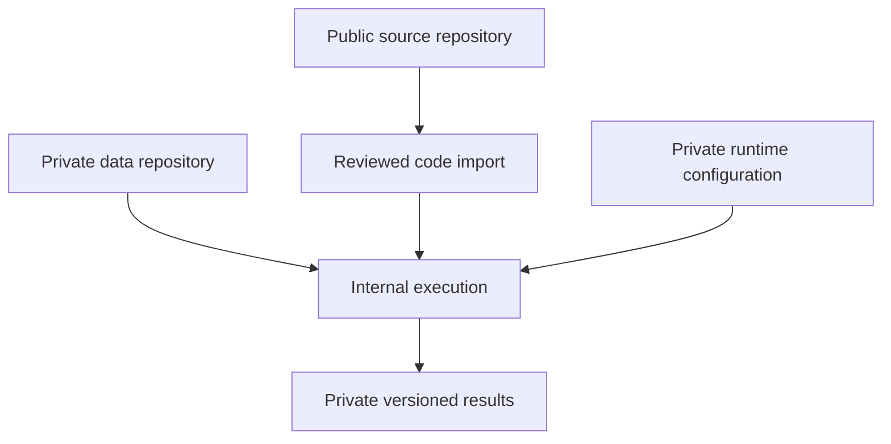

# Architecture

One public code repository contains the reusable modules. Private inputs and
derived artifacts use separate storage and a separate access policy. This first
release packages the modules together to avoid duplicating security, configuration
and provenance logic. They can become separately versioned packages later.

The diagram describes the internal processing path. A separate public CI job
tests source with generated inputs. There is no data or results flow back to the
public repository.

| Component | Module | Output location |
| --- | --- | --- |
| Pinned private source acquisition | `security.sync_private` | Private workspace |
| Local snapshot and automatic setup | `autorun`, `families` | Private inputs, setup and run configuration |
| Input verification and guarded corrections | `io` | Private run audits |
| Filtering and interval construction | `curation` | Private dataset |
| Deduct targets and curve-based PCI | `distress`, `pci` | Private dataset |
| Feature admission and association review | `features` | Private feature set and audit |
| Condition-adjusted ranking | `ranking` | Private rankings |
| Grouped model search | `modeling`, `metrics` | Private models and diagnostics |
| Immutable run orchestration | `pipeline` | Private manifest and run report |
| Consolidated visualization | `reporting` | Private CSVs and offline HTML dashboard |
| Source publication checks | `tools/check_public_tree.py` | Fixed pass/fail status |

## Private workspace

The operator selects a private root outside the code checkout. Source revisions
are placed under `sources/<commit>`; local exports may instead be kept under
`inputs`. Configuration, optional correction tables and curve profiles are
external files. Versioned results use `runs/<version>` or another configured
child directory. `logs` and `failed` hold private diagnostics.

Do not initialize Git at the workspace root. The private source checkout can be
versioned, but the program rejects output paths beneath it. Input and output
trees must be disjoint. Failed-run audits are retained privately and do not
overwrite a completed version.

## Execution and provenance

The pipeline reads only files named in the private configuration. It hashes
source bytes, configuration, optional correction/curve files, generated setup
metadata and original snapshots when supplied, the package source
and dependency versions. It checks that inputs have not changed while the run
was executing. Every output file is hashed into the run manifest.

A completed output directory is immutable. `--resume` returns it only when the
input fingerprint and complete output checksum map match. It detects deleted,
edited and extra output files. A changed input or code revision requires a new
output version. The initial implementation resumes whole completed runs; it
does not restart individual completed stages inside a failed run.

The manifest contains private provenance and must be treated as data. Hashes,
row keys, filenames, model diagnostics and aggregate results are not publication
artifacts.
